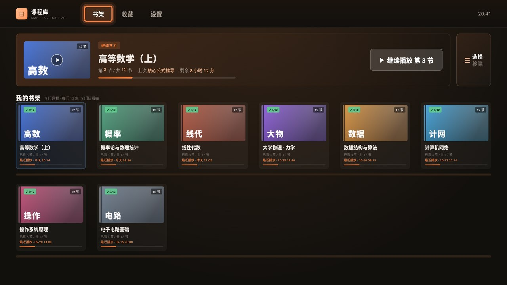
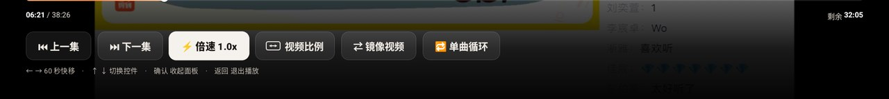
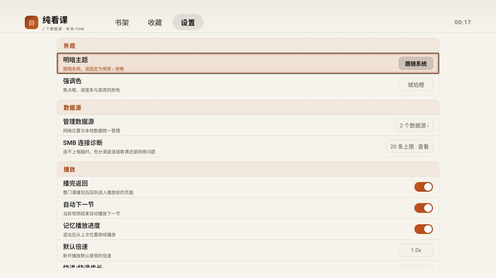
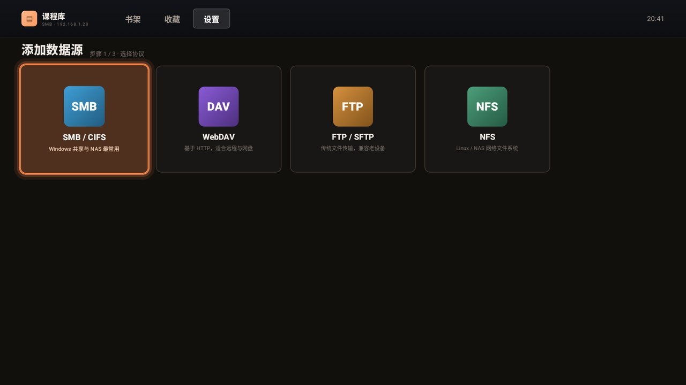

<div align="center">

# 纯看课 · PureCourse

**把 NAS、Windows 共享、网盘里的课程视频，整理成电视上的书架。**

遥控器五键走完全流程 · 三种数据源并存 · 硬解起播约 0.5 s · 全程不联网


[下载安装](#下载与安装) · [功能亮点](#功能亮点) · [从源码构建](#从源码构建) · [开发文档](docs) · [更新日志](docs/CHANGELOG.md)

</div>

---

## 截图

| 书架 | 播放控制层 |
|:---:|:---:|
|  |  |
| **设置** | **添加数据源** |
|  |  |

> 界面 100% 自研：Compose for TV 只借主题基座，控件、焦点、播控层全部手写。
> 所有功能都能**只用遥控器**闭环，不需要鼠标、不需要手机扫码当遥控。

---

## 为什么是「纯看课」

电视上的课程视频通常是这样放的：
`服务器 → 共享名 → 学科 → 年级 → 学期 → 第 3 讲 分子结构.flv`。
层级深浅不一，文件名带编号和下载器尾巴（`第1节：引导课(15300).flv`），U 盘一插、网盘一换就全乱。

本项目的做法：

- **一门课 = 一个"直接含视频文件"的目录**：课名取目录名，集数取真实视频文件个数（4 集、12 集、79 集都行，不写死）
- **文件名清洗成可读标题**：去扩展名、去尾部 `(15300)` 这类下载器 ID，`第10节` 用自然序排在 `第2节` 后面
- **按目录路径落库**：不用会随排序变化而移位的课程 id，冷启动不丢进度
- **进度、收藏、备注名、加入书架的目录**全部跨冷启动保留
- **不联网**：不刮削、不上报、不请求任何第三方接口，封面是内置渐变色

## 功能亮点

| 能力 | 说明 |
|---|---|
| **三种数据源并存** | SMB / CIFS（SMB2/3，支持整机模式）、WebDAV（OpenList / Alist / Nextcloud / 群晖等，可选自签证书直通）、本地存储（内置存储 / U 盘 / SD 卡，插拔自动探测） |
| **点哪层读哪层** | 2.0 数据层重写：启动只读根目录一层（1 次请求）、书架上每门课只读它自己那一层（每门课 1 次）、点开一本书先用手里的集数立刻显示再后台刷新。冷启动不再等整棵树扫完 |
| **浏览与播放分池** | 浏览请求走独立连接池（并发 6、不重试），播放走原通道；翻目录不会把正在播的视频卡住 |
| **视频画幅 6 档** | 原始比例 / 铺满屏幕 / 16:9 / 4:3 / 21:9 / 拉伸全屏。按 **DAR（含 SAR）** 出画，`1440×1080 + SAR 4:3` 这类老课件不再被横向压窄 |
| **倍速 / 镜像 / 单曲循环** | 0.5×–2.0× 任意倍速；镜像用于镜像投屏或反打素材；单曲循环适合跟练 |
| **自研焦点系统** | 区域导航 `REG / EXIT / NAV`：每个区域声明方向与列数，方向键按下标算目标、越界走显式出口。书架 6 列，末行不满时落到最接近的一列，没有用系统 FocusFinder 的几何死角 |
| **分辨率无关** | 逻辑画布 1920×1080 等比缩放，1080P / 2K / 4K 面板同一套布局，不出黑边不拉伸 |
| **SMB 会话恒 1 条** | 串行化 IO + 断线自愈，不撞 Windows 并发会话上限（家庭版 20 条） |
| **调试包共存** | `com.chunting.purecourse.dbg`（桌面显示「课程库·调试」）可与正式包同时安装，数据互不干扰 |

## 下载与安装

到 [**Releases**](https://github.com/jojotj/PureCourse/releases) 下载对应 ABI 的包，或直接用仓库里 [`dist/`](dist) 的同名文件：

| 文件 | 适用 |
|---|---|
| `PureCourse-2.0.8-clean-armeabi-v7a.apk` | **大多数电视 / 盒子**（32 位，优先选这个） |
| `PureCourse-2.0.8-clean-arm64-v8a.apk` | 64 位机型（新款电视、部分盒子） |

装法两条路：

```bash
# 路线 A：U 盘 + 电视自带安装器（最稳）
#   拷进 U 盘时请用**短英文文件名**：长中文名曾导致 classes.dex 单块损坏
#   （v2 验签 CHUNKED_SHA256 digest mismatch），与包本身无关

# 路线 B：adb（开发用，需要电视已开 ADB 调试）
adb install -r dist/PureCourse-2.0.8-clean-armeabi-v7a.apk
adb shell am start -n com.chunting.purecourse/com.chunting.purecourse.MainActivity
```

> 首启是空的：`clean` 包里**不含任何预置数据源**，到「设置 → 数据源 → 添加」填一次你的 NAS / 共享 / WebDAV 地址即可。
> Release 包显式开启了 **v1 (JAR) 签名**——部分电视（如 TCL MT5879 / Android 11）的安装校验器只认 v1，
> 缺了会直接报 `INSTALL_FAILED_VERIFICATION_FAILURE`，与包内容无关。

**设备基线**：minSdk 21（Android 5.0）、targetSdk 34、compileSdk 36；
实测目标机 TCL MT5879（Android 11 / API 30 / armeabi-v7a）：走 `OMX.MS.AVC.Decoder` 硬解，起播约 500 ms，1× 播放掉帧 0.00%。

## 遥控器操作

| 动作 | keycode |
|---|---|
| 上 / 下 / 左 / 右 | 19 / 20 / 21 / 22 |
| 确认 | 23 或 66 |
| 返回 | 4 |

- 播放页全屏态按**确认 = 播放/暂停**，不是"收起控制层"；控制层出现后确认才执行焦点控件
- 返回键分级：关弹层 → 退播放 → 退详情 → 退区域，逐层收回，不会一下退出应用

## 从源码构建

环境：JDK 17+（实测 21）、Android SDK（`compileSdk 36`）。

```powershell
$env:JAVA_HOME = "<你的 JDK 目录>"

# 对外发布用的干净包（推荐）：产出两个 ABI 到 dist/
.\gradlew.bat :app:assembleCleanRelease --console=plain

# 调试包
.\gradlew.bat :app:assembleDebug --console=plain
```

产物在 `app/build/outputs/apk/<flavor>/release/app-<flavor>-<abi>-release.apk`（按 ABI 拆包，无 universal），
`dist/` 下的归档由 `copyReleaseApksToDist` 任务自动完成。

**两个 flavor（`preset` 维度）**

| flavor | 用途 | 预置数据 |
|---|---|---|
| `clean` | 对外发布，首启全空 | 全空，dex 里不含任何主机信息 |
| `local` | 自用，首启直接连本机共享 | 本机 SMB 地址 / 账号 / 快捷位置 |

`local` 的预置值属于个人内网信息，仓库里只提供模板：
把 `app/src/local/java/com/chunting/purecourse/data/BuiltinPresets.kt.example` 复制成同目录的 `BuiltinPresets.kt`，
填上你自己的主机、共享名与账号即可（复制出来的 `.kt` 已被 `.gitignore` 忽略）。

两个 flavor 的包名、签名、versionCode 相同，可互相覆盖安装且**不会清数据**（数据都在 App 私有目录）。

**签名**：`keystore/courseplayer.jks` 不入库，口令从 `local.properties`（`signing.storePassword` / `signing.keyPassword`）
或环境变量（`PURECOURSE_STORE_PASSWORD` / `PURECOURSE_KEY_PASSWORD`）读取；
没有 keystore 时 release 自动退回 debug 签名，仍能出包安装。要打自己的包，换上自己的 keystore 即可。
生成方式见 [`keystore/README.md`](keystore/README.md)。

## 架构

```
app/src/main/java/com/chunting/purecourse/
├── MainActivity.kt          单 Activity，dispatchKeyEvent 统一接管五键
├── core/Dims.kt             设计令牌（颜色 / 圆角 / 焦点环）
├── data/
│   ├── Model.kt             Course · Episode · FsItem · Proto · Source
│   ├── RealCatalog.kt       SMB / 本地 扫描与列目录
│   ├── DavCatalog.kt        WebDAV 目录层，产出与 RealCatalog 同构的快照
│   ├── DavClient.kt         PROPFIND / 播放通道（浏览池 + 播放池）
│   ├── SmbSession*.kt       smbj 会话、串行化 IO、断线自愈
│   ├── SourceStore.kt       数据源 / 书架 / 收藏 / 隐藏路径持久化
│   └── LocalStore.kt        挂载点探测（U 盘 / SD 卡）
├── state/
│   ├── AppState.kt          全部状态 + 动作（含 refreshCourseDir / ensureNode）
│   ├── Nav.kt               区域导航 REG / EXIT + 各页交互动作
│   └── KeyRouter.kt         五键分层路由 + 分级返回
├── ui/
│   ├── Stage.kt             1920×1080 逻辑画布等比缩放
│   ├── TvWidgets.kt         文本 / 封面渐变 / 进度条 / 自绘图标
│   ├── Overlays.kt          多选条 / Toast / 二次确认 / 文件夹小框
│   └── pages/               Shelf · Fav · Detail · Browse · Settings · Sources · AddSource · Player
└── player/                  PlaybackEngine · Media3Engine · SmbDataSource
```

技术栈：Kotlin · Jetpack Compose for TV · Media3 / ExoPlayer（自写 `SmbDataSource` 与 WebDAV OkHttp 数据源）· smbj。
**全程硬解，不引 ffmpeg / libmpv**——PoC 阶段实测结论见 [`docs/03-内核PoC报告.md`](docs/03-内核PoC报告.md)。

## 开发文档

设计取舍、真机验收数据、踩过的坑都写在 [`docs/`](docs)：

| 文档 | 内容 |
|---|---|
| [01-页面拓扑与交互约束](docs/01-页面拓扑与交互约束.md) | 页面清单、区域划分、返回键分级 |
| [03-内核PoC报告](docs/03-内核PoC报告.md) | Media3 与 libmpv 实测对比（结论：不引 ffmpeg） |
| [06-分辨率适配](docs/06-分辨率适配.md) | 1080P / 2K / 4K 为何显示一致 |
| [07-SMB连接策略](docs/07-SMB连接策略.md) | 如何只占一条会话、能查什么、能清什么 |
| [12-电视真机专项验收](docs/12-电视真机专项验收.md) | 硬解路径、起播 / 倍速性能、遥控器与 TV 输入法 |
| [15-多源并存(M2)交付说明](docs/15-多源并存%28M2%29交付说明.md) | SMB / WebDAV / 本地三源并存的路径模型 |
| [CHANGELOG](docs/CHANGELOG.md) | 逐版变更 |
| [PUBLISHING](docs/PUBLISHING.md) | 发布前脱敏与归档记录 |

> 文档正文保留，但开发过程中的 500+ 张验收截图**不随仓库分发**（体积原因），README 里的 4 张是精选后的成品图。

## 已知边界

- 只自动识别「直接含视频文件的目录」这一种课程结构，更深层混排需要手动「加入书架」
- 不做在线刮削，封面取自内置渐变配色，不联网
- 收藏左栏的「按协议分组小标题」、书架手动排序：未做
- WebDAV 各家 `PROPFIND` 实现差异较大（有的不返回 `getcontentlength`），列表能做、体积可能显示为空
- 4K 面板上系统只给 1080p 画布，HWC 放大 2× 会让字发虚；已用放大字号缓解，App 侧无法根治

## 许可

[MIT](LICENSE)
